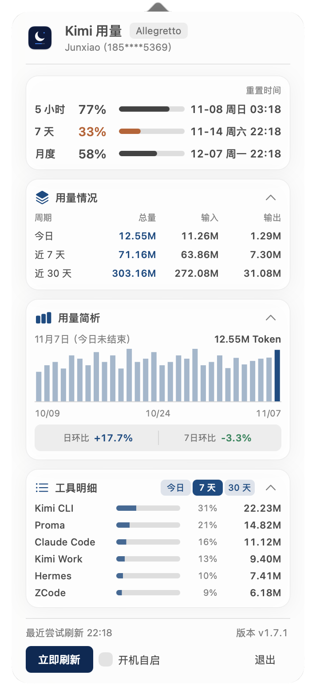

# KimiUsage

**Kimi 额度与用量，在 Mac 菜单栏一眼看清。**

无需反复打开页面：查看 5 小时、7 天和月度额度，掌握重置时间，也能回顾近期 Token 用量与工具分布。

**[下载 KimiUsage](https://github.com/JUNX7764/kimi-usage-menubar/releases/latest)** · macOS 13 或更高版本 · Apple Silicon

 

截图使用演示数据，展示当前版本界面。

## 能做什么

- **额度与重置时间**：菜单栏显示 5 小时和 7 天剩余额度，点开查看月度额度及各周期重置时间；面板头部展示当前登录账号（昵称与打码手机号，CodexUsage 头部同款布局）。
- **分层卡片面板**：额度、周期用量、每日趋势和工具明细独立分组，支持明暗外观；固定头部与操作区，内容超高时在面板内滚动。
- **周期用量总览**：查看今天、近 7 天和近 30 天的 Token 总量、输入与输出；点击周期行可展开模型明细，刷新后保留展开状态。
- **每日趋势与对比**：近 30 天柱状图支持按日查看，并提供日环比、7 日环比；数据不足时明确提示，不猜测缺失用量。
- **工具明细**：按周期查看 Kimi Work、Kimi CLI、Proma、Claude Code、ZCode、Hermes 的用量、占比和读取状态。
- **省心常驻**：自动刷新，也可手动刷新全部数据；支持开机自启、面板内更新进度和异常或数据过期提示。

## 统计口径

额度来自当前登录的 Kimi 账号。Token 统计来自本机可读取的会话与客户端记录，可能包含 API 调用、不同账号或订阅归属未确认的记录，**不代表订阅账单或所有设备的总用量**。

近 7 天和近 30 天均包含今天。每日趋势、周期对比与工具明细使用同一份本地聚合数据；API 客户端部分只统计识别到的 Kimi / Moonshot 用量。

## 安装

1. 安装并登录 Kimi 桌面端；应用从其本机配置读取查询额度所需的登录信息。
2. 在[下载页面](https://github.com/JUNX7764/kimi-usage-menubar/releases/latest)下载 `KimiUsage.dmg`。
3. 打开安装包，将 KimiUsage 拖入「应用程序」，然后打开。首次打开如遇系统安全提示，可右键点击应用并选择「打开」。

打开后，点击屏幕顶部菜单栏中的 KimiUsage 即可查看详情。额度能否显示取决于账号、登录状态及对应订阅是否可用。

## 更新

有新版本时，面板会提示更新。点击后可在应用内查看下载和安装进度；关闭面板后更新会继续，再次打开可查看进度，完成后自动重启。也可点击面板底部的版本号手动检查。

从旧版升级到首次支持应用内进度的版本时，仍会打开一次终端窗口；此后更新使用新界面。

## 数据与隐私

**本机会话记录和用量统计在 Mac 上处理，不会上传到开发者服务器。**

查询额度需要向 Kimi 服务发送必要的认证信息；检查更新会连接 GitHub。登录信息过期时，应用可能续期并更新 Kimi 桌面端的本地认证信息。面板头部的账号行（昵称与打码手机号）来自 Kimi 的用户信息接口，手机号由服务端打码返回，仅用于本机展示。

## 其他工具

- [CodexUsage](https://github.com/JUNX7764/Codexusage)：查看 Codex 额度和用量
- [GlmUsage](https://github.com/JUNX7764/Glmusage)：查看 GLM Coding Plan 额度和用量

[开发与维护](docs/DEVELOPMENT.md) · [MIT License](LICENSE)
