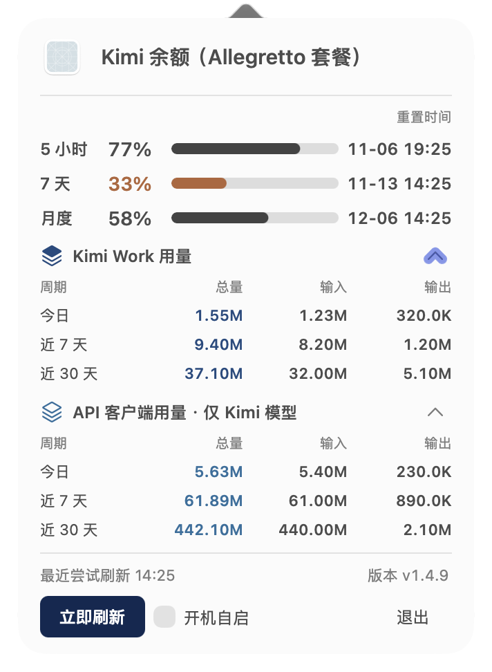

# KimiUsage

**Kimi 额度与用量，随时可见。**

不用反复打开页面，在 Mac 菜单栏查看还剩多少、什么时候恢复，以及近期用了多少 Token。

[下载 KimiUsage](https://github.com/JUNX7764/kimi-usage-menubar/releases/latest) · macOS 13 或更高版本 · Apple Silicon

**本地统计会话用量，不上传会话记录。**

*界面展示的是示例数据。*

## 能做什么

- **随时看额度**：菜单栏显示 5 小时和 7 天剩余额度；点开可查看月度额度。
- **知道何时恢复**：查看各额度的重置时间，方便安排使用。
- **了解使用情况**：查看 Kimi Work 和 API 客户端今天、近 7 天及近 30 天的 Token 用量；点击任一周期整行可展开或收起各模型的总量、输入和输出，刷新后保留展开状态。
- **及时发现异常**：数据更新失败或过期时，面板会给出提示。

Token 统计来自本机可读取的会话记录，覆盖 Kimi Work、Kimi Code CLI、ZCode、Proma、Claude Code、Hermes Agent 等支持的来源；API 客户端部分只统计识别到的 Kimi / Moonshot 用量，不能视为所有设备或所有模型的总用量。

## 安装

1. 先安装并登录 Kimi 桌面端；应用从其本机配置读取查询额度所需的登录信息。
2. 在[下载页面](https://github.com/JUNX7764/kimi-usage-menubar/releases/latest)下载 `KimiUsage.dmg`。
3. 打开安装包，将 KimiUsage 拖入“应用程序”，然后打开它。首次打开如遇系统安全提示，可右键点击应用并选择“打开”。

打开后，在屏幕顶部菜单栏点击 KimiUsage 即可查看详情。额度能否显示取决于账号、登录状态及对应订阅是否可用。

## 更新

有新版本时，面板会提示更新。点击后可以在应用内查看下载和安装进度，完成后自动重启。也可点击面板底部的版本号手动检查。

从旧版升级到首次支持应用内进度的版本时，仍会打开一次终端窗口；此后更新使用新界面。

## 数据与隐私

**本机会话记录和用量统计在 Mac 上处理，不会上传到开发者服务器。**

查询额度需要向 Kimi 服务发送必要的认证信息；检查更新会连接 GitHub。登录信息过期时，应用可能续期并更新 Kimi 桌面端的本地认证信息。

## 其他工具

- [CodexUsage](https://github.com/JUNX7764/Codexusage)：查看 Codex 额度和用量
- [GlmUsage](https://github.com/JUNX7764/Glmusage)：查看 GLM Coding Plan 额度和用量

[开发与维护](docs/DEVELOPMENT.md) · [MIT License](LICENSE)
